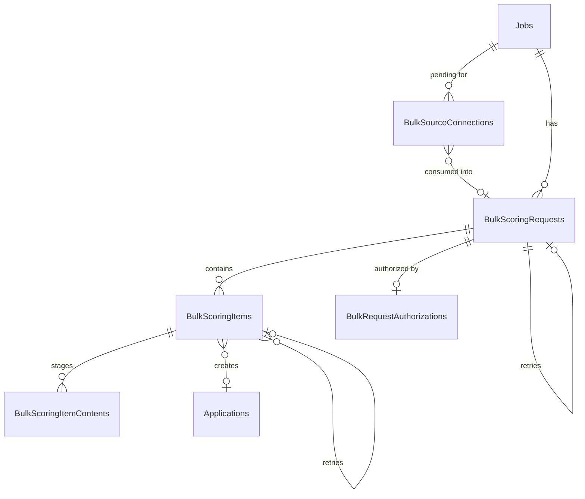
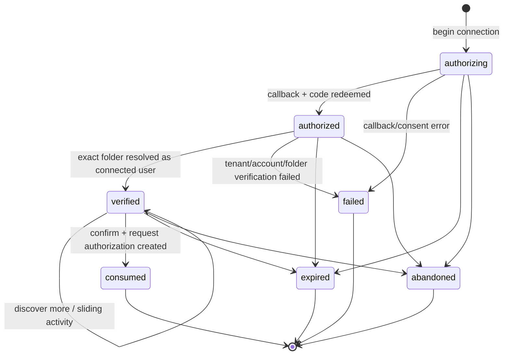
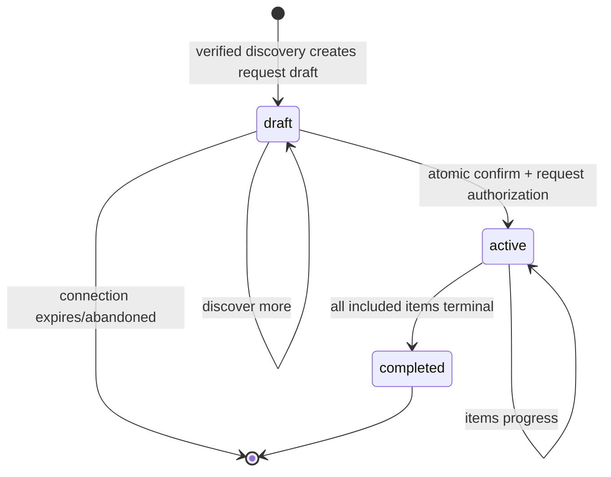
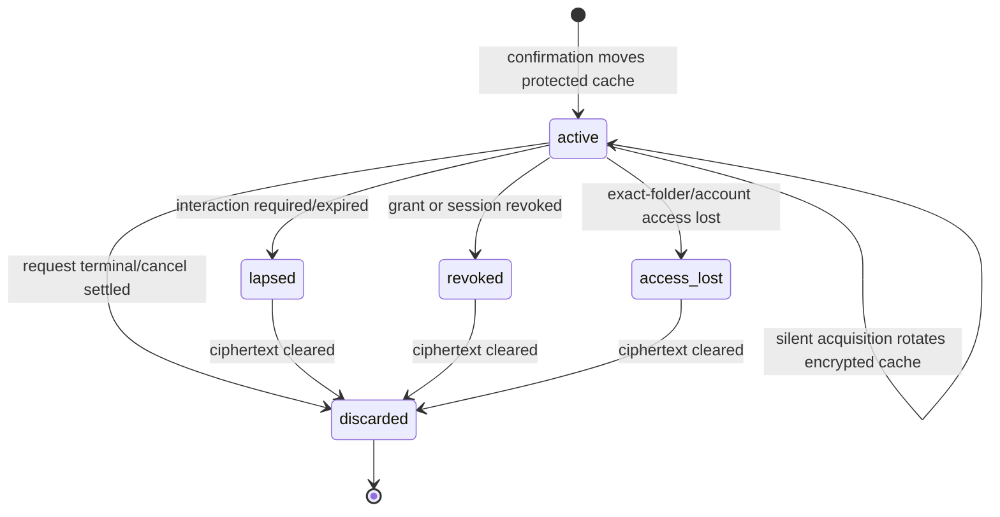

# Phase 1 Data Model: Delegated Microsoft 365 Bulk Scoring

**Feature**: `001-sharepoint-bulk-scoring`  
**Spec**: [spec.md](./spec.md)  
**Research**: [research.md](./research.md)  
**Status**: Planned target model until sequenced old-runtime removal and provider migrations pass.
**Contract Revision**: OpenAPI 3.1.0 planned target; public model ownership is mapped to operation
IDs by `contracts/openapi.yaml`.

Stack B EF Core migrations are the schema authority. Stack A must adopt the same tables, columns,
constraints, and enum literals after B-GATE. Existing request/item/content/settings tables remain,
but the former access-model fields and OBO-only authorization shape are replaced. The resulting
model has seven feature tables:

1. `BulkSourceAdmissionEvents` — short-lived distributed admission records with no raw source IP.
2. `BulkSourceConnections` — short-lived, encrypted, pre-confirmation connector state.
3. `BulkScoringRequests` — durable request and exact verified source folder.
4. `BulkScoringItems` — one included source file per row.
5. `BulkScoringItemContents` — staged original/converted content.
6. `BulkImportSettings` — administrator-configurable maximum file count.
7. `BulkRequestAuthorizations` — encrypted authorization used only by one accepted request.

Every lifecycle transition writes a non-secret entry to the existing immutable audit ledger.
Terminal notifications are a projection of `BulkScoringRequests`, not an eighth feature table:
the unique request terminal transition creates notification state and the retained acknowledgment
stays on that same row.

## Existing immutable audit ledger contract

The existing ledger remains outside the seven feature tables and outside all job/request cascades.
Every new event uses this typed envelope in Stack A and Stack B:

| Field | Rule |
| --- | --- |
| `AuditEventId` | Immutable unique identifier |
| `EventType` | Closed event literal from the matrix below |
| `CorrelationId` | Required; copied through endpoint, transaction, queued work, timer, and reconciliation continuations |
| `ActorType` | Required closed enum: `user` for an authenticated user action or `service` for worker/timer/cleanup/reconciliation work |
| `ActorId` | Required actor that performed the mutation: product user ID for `user`, stable non-secret worker/service ID for `service` |
| `InitiatedByActorId` | Optional product user that initiated background work; never replaces the required service actor |
| `OccurredAt` | Required UTC timestamp written with the state transition |
| `SubjectType`, `SubjectId` | Opaque type/reference; never a source name, path, URL, account, or content identifier |
| `SafeFacts` | Versioned typed object limited to safe states/reasons, counts, and configuration versions |
| `SchemaVersion` | Required event-payload contract version |

The event matrix is:

| Mutation boundary | Closed event literals | Required actor |
| --- | --- | --- |
| Source connection creation/completion/failure/expiry/consume | `source_connection_created`, `source_connection_completed`, `source_connection_failed`, `source_connection_expired`, `source_connection_consumed` | user for start/callback/consume; explicit timer service for expiry |
| Preview draft create/discover/abandon | `preview_draft_created`, `preview_discovery_committed`, `preview_draft_abandoned` | user for explicit preview/discover/abandon; expiry service when abandonment is automatic |
| Discovered item row creation | `bulk_item_discovered` | user for synchronous explicit discovery or discovery worker service |
| Request confirmation/cancellation/retry request | `bulk_request_confirmed`, `bulk_request_cancellation_requested`, `bulk_request_retry_created` | authenticated user |
| Item claim, lease, and import start | `bulk_item_claimed`, `bulk_item_lease_renewed`, `bulk_item_lease_recovered`, `bulk_item_lease_released`, `bulk_item_import_started` | worker service |
| Source metadata recheck outcome | `bulk_item_source_metadata_recheck_succeeded`, `bulk_item_source_metadata_recheck_failed` | import worker service |
| Original/converted staging and fingerprint persistence | `bulk_original_content_staged`, `bulk_converted_content_staged`, `bulk_item_fingerprint_recorded` | import or conversion worker service |
| Duplicate arbitration | `bulk_item_duplicate_claimed`, `bulk_item_duplicate_skipped` | import worker service |
| Conversion lifecycle | `bulk_item_conversion_started`, `bulk_item_conversion_completed`, `bulk_item_conversion_failed` | conversion worker service |
| Invalid converted output disposition | `bulk_converted_output_quarantined`, `bulk_converted_output_removed` | conversion or cleanup worker service |
| Application/document creation | `bulk_item_application_created`, `bulk_item_document_created` | import/handoff worker service |
| Scoring ownership boundary | `bulk_item_scoring_handoff_queued`; `bulk_item_scoring_started` only when this feature owns the scoring-start transition | handoff/scoring worker service |
| Item terminal transitions | `bulk_item_completed`, `bulk_item_failed`, `bulk_item_skipped`, `bulk_item_cancelled` | worker service; user remains optional initiating actor for cancellation |
| Retry item creation | `bulk_retry_item_created` | authenticated user for synchronous retry creation or explicit retry service when materialized asynchronously |
| Request count reconciliation | `bulk_request_counts_reconciled` | finalizer/reconciliation service |
| Request outcome/final terminal state | `bulk_request_terminal_finalized` | finalizer service |
| Notification creation/acknowledgment | `bulk_notification_created`, `bulk_notification_acknowledged` | finalizer service for creation; authenticated owner for acknowledgment |
| Authorization establish/use/lapse/discard | `request_authorization_established`, `request_authorization_used`, `request_authorization_lapsed`, `request_authorization_discarded` | user for establishment; worker/timer service for background use/lapse/discard |
| Original/converted/transient content deletion | `bulk_original_content_deleted`, `bulk_converted_content_deleted`, `bulk_transient_content_deleted` | cleanup service |
| Item/request/content reconciliation corrections | `bulk_item_reconciliation_corrected`, `bulk_request_reconciliation_corrected`, `bulk_content_cleanup_reconciliation_pending`, `bulk_content_cleanup_reconciliation_completed` | reconciliation service |
| Settings mutation | `bulk_settings_changed` | authenticated administrator |
| Job deletion cleanup | `bulk_job_cleanup_completed`, `bulk_job_cleanup_pending` | user for deletion request provenance plus explicit cleanup service on background decisions |

Every row is mandatory when its mutation occurs. If one transaction performs multiple typed
mutations—such as conversion failure plus item failure, or item terminalization plus request-count
change—every applicable event is inserted in that transaction; a summary event does not replace
another row.

For relational state, the state update and events are one SQLite/Azure SQL transaction and audit
insert failure rolls back the state. Scoring publication first atomically commits the durable
handoff/outbox mutation and `bulk_item_scoring_handoff_queued`; delivery retry is not a second queue
event unless state changes. External content quarantine/removal/deletion cannot share a database
transaction, so the implementation atomically records the durable intent/outcome or reconciliation
correction and its event, performs idempotent I/O, then records the next typed outcome. Product APIs
expose no ledger mutation/deletion operation.

Job deletion must leave all events queryable after relational and staged-content cleanup. Allowed
facts are opaque connection/job/request/item/authorization references, safe state/reason/outcome
codes, content-kind enums, counts/bytes, and configuration versions. Prohibited facts are
source/folder/item names or URLs, raw source account identity/email, content/fingerprints,
authorization codes, tokens, verifiers, caches, keys, provider payloads/errors, and environment
identifiers. Provider tests must prove identical event type, correlation, actor type/ID,
initiating-user semantics, UTC timestamp, safe-fact schema, atomic rollback, append-only retention,
and survival across Stack A and Stack B on SQLite and Azure SQL.

## Product-environment publisher gate (not persisted source data)

Publisher verification is validated configuration, not a request, connection, tenant, or folder
field. Its function accepts only the normalized product deployment environment and the explicit
connector publisher-verification assertion:

| Product environment | Assertion | Result |
| --- | --- | --- |
| Production | `true` | publisher gate passes; normal product/source authorization still applies |
| Production | absent or `false` | feature registration/startup fails closed |
| explicitly controlled Development or QA | absent or `false` | connector may activate; normal product/job authorization remains mandatory |
| any other uncontrolled environment | absent or `false` | connector remains unavailable |

No `SourceTenantId`, account, host, site, drive, folder, consent result, or allow-list is an input to
this gate. When it rejects, no `BulkSourceConnection`, admission/token state, authorization-code
redemption, Graph request, or source read can exist. Source tenant is validated later only for
organizational commercial-cloud authorization and never for rollout gating.

## Relationship diagram

## `BulkSourceAdmissionEvents`

Short-lived rows provide one cross-instance admission decision for both stacks. They are not audit
events and are deleted after their rolling window.

| Column | Type | Rules |
| --- | --- | --- |
| `Id` | GUID/text PK | random |
| `Kind` | enum | `connection_actor`, `connection_ip`, `callback_ip` |
| `SubjectHash` | text | HMAC of product actor or normalized source IP with an environment-owned rotating key; raw IP is never stored |
| `OccurredAt`, `ExpiresAt` | timestamp | one-minute rolling window; indexed expiry |

Admission is transactional. Before creating state or touching Entra/Graph, start rejects when the
actor already has 10 unexpired non-terminal pending connections, or when adding an admission row
would exceed 10 actor starts/minute or 30 source-IP starts/minute. Callback rejects before state
lookup/code redemption when adding a row would exceed 60 callbacks/minute/source IP. Rejection does
not insert a connection and performs no authorization-code redemption, token acquisition/refresh,
Graph call, or source read. Cleanup may delete expired rows at any time.

## `BulkSourceConnections`

Short-lived server-side state for authorization, callback, exact-folder verification, discovery,
and confirmation. It is never a reusable account connection.

| Column | Type | Rules |
| --- | --- | --- |
| `Id` | GUID/text PK | random, not derived from user/folder |
| `ProductActorId` | text | required; product identity, not source identity |
| `JobId` | FK → `Jobs` | required; job authorization rechecked on every call |
| `Status` | enum | `authorizing`, `authorized`, `verified`, `consumed`, `expired`, `abandoned`, `failed` |
| `CanonicalUrlHash` | text | SHA-256 of normalized pasted URL; URL itself is not placed in OAuth state |
| `PendingFolderUrlEncrypted` | binary | envelope encrypted until stable Graph identity is known |
| `StateHash` | text | one-way hash of OAuth state; unique while active |
| `PkceVerifierEncrypted` | binary | envelope encrypted; cleared immediately after callback redemption |
| `RedirectAfterPath` | text | local relative route only; job page + connection ID, never an absolute URL |
| `SourceTenantId` | text null | validated `tid` returned by Entra |
| `SourceAccountBindingHash` | text null | HMAC binding of stable home-account/object identifier; raw identifier stays inside encrypted payload |
| `SourceAccountDisplay` | text null | optional safe display label |
| `SourceKind` | enum null | `sharepoint` or `onedrive_business`, set after Graph verification |
| `SourceCloud` | enum null | must be `commercial`; every other cloud is rejected before source access |
| `SourceDriveId`, `SourceFolderItemId` | text null | stable exact-folder identity |
| `SourceFolderName`, `SourceFolderPath`, `SourceWebUrl` | text null | set only after delegated verification |
| `ProtectedPayload` | binary null | envelope-encrypted MSAL token-cache partition |
| `WrappedDataKey`, `KeyVersion` | binary/text null | Key Vault wrapped per-record AES key |
| `ObtainedAt`, `LastActivityAt` | timestamp | absolute/sliding lifetime anchors |
| `ExpiresAt` | timestamp | min(`LastActivityAt + 30m`, `ObtainedAt + 2h`) |
| `ConsumedByRequestId` | FK nullable | write once on confirmation |
| `DiscardedAt`, `FailureCode` | timestamp/text null | no raw identity-provider errors |
| `ConcurrencyVersion` | integer | optimistic concurrency |

**Constraints and indexes**

- Unique active `StateHash`; index `(ProductActorId, JobId, Status, ExpiresAt)`.
- Protected material and PKCE verifier are present only in states that require them.
- `verified` requires tenant/account/source kind/drive/folder fields.
- `consumed` requires `ConsumedByRequestId`, cleared ciphertext, wrapped key, verifier, and URL.
- Associated data for envelope encryption is
  `bulk-source-connection:{Id}:{ProductActorId}:{JobId}:{CanonicalUrlHash}`.
- A connection cannot be loaded by actor/job alone; every access checks the complete binding.
- At most 10 unexpired connections in `authorizing|authorized|verified` may exist for one actor.

### Connection state machine

`source_admin_consent_required` is a resumable authorization outcome, not a terminal connection status:
the record stays `authorizing`, rotates state/PKCE before the next attempt, and reveals no folder
content.

## `BulkScoringRequests`

| Column | Type | Rules |
| --- | --- | --- |
| `Id` | GUID/text PK | |
| `JobId` | FK → `Jobs` | required |
| `OwnerActorId` | text | product user who confirmed |
| `Status` | enum | `draft`, `active`, `completed` |
| `Outcome` | enum null | `all_succeeded`, `partial`, `failed`, `cancelled` |
| `SourceKind` | enum | `sharepoint`, `onedrive_business` |
| `SourceTenantId`, `SourceAccountBindingHash` | text | source authorization binding; raw account ID is not a clear column |
| `SourceDriveId`, `SourceFolderItemId` | text | immutable exact-folder identity |
| `SourceFolderName`, `SourceFolderPath`, `SourceWebUrl` | text | safe display fields |
| `ConvertToRasterPdf`, `AllowDuplicates` | bool | immutable after confirmation |
| `RasterDpi` | integer | frozen configured DPI used for initial conversion; positive |
| `CapturedScoringConfigVersionId` | text | version current at confirmation; immutable provenance |
| `MaxFilesPerRequest` | integer | frozen at first discovery; 1–100,000 inclusive |
| `MaxBytesPerFile` | bigint | frozen bytes; unsaved default 8,388,608 |
| `MaxTotalBytes` | bigint | frozen bytes; 1,048,576–1,099,511,627,776; default 53,687,091,200 |
| `DiscoveryStepMaxFiles` | integer | frozen; at most 1,000 |
| `DiscoveryStepMaxEntries`, `DiscoveryStepMaxSeconds` | integer | positive frozen scan guards |
| `DiscoveryStatus` | enum | `more_available`, `complete`, `limit_reached` |
| `DiscoveryCursorJson` | encrypted text/binary null | server-only Graph traversal state |
| `EntriesScanned`, `DiscoveryStepCount` | integer | non-negative |
| `DraftReviewVersion` | integer | increments only after a discovery step commits; starts at 1 |
| `IncludedItemCount`, `IncludedBytes` | integer/bigint | stable review total and byte sum for current review version |
| `ExcludedByReasonJson` | text | counts only; excluded names are never stored |
| `RetryOfRequestId` | FK self null | immutable |
| `ConnectionId` | FK → `BulkSourceConnections` | provenance; source secrets already removed |
| `CreatedAt`, `ConfirmedAt`, `CancelRequestedAt`, `TerminalAt`, `AcknowledgedAt` | timestamp null | `ConfirmedAt` is accepted-request submission time; terminal and acknowledgment times are write-once |
| `CancelledByActorId` | text null | written with `CancelRequestedAt` on the first cancellation request |
| `AcknowledgedByActorId` | text null | written with `AcknowledgedAt`; must equal `OwnerActorId` |
| `ConcurrencyVersion` | integer | optimistic concurrency |
| Denormalized counts | integers | discovered/excluded/inaccessible and every item status |

Removed fields: `AccessModel`, `SourceTenantId` as deployment configuration, and `OwningStack`.
`SourceTenantId` now comes only from the connected source account. Workers never select an identity
mode; all live source reads require `BulkRequestAuthorizations`.

**Indexes/invariants**

- `(JobId, CreatedAt DESC)`, `(OwnerActorId, Status, AcknowledgedAt)`, `(Status, TerminalAt)`.
- Outcome is non-null exactly when status is `completed`.
- `IncludedItemCount <= MaxFilesPerRequest` and `IncludedBytes <= MaxTotalBytes`.
- A discovery transaction increments `DraftReviewVersion` only after all newly included items,
  counts, bytes, exclusions, and the discovery cursor commit.
- Item-status counters are updated transactionally and verified at finalization.
- The first terminal compare-and-set writes `Outcome`, `TerminalAt`, and final
  completed/failed/skipped/cancelled counters in one transaction. These immutable values are the
  terminal-notification payload.
- `AcknowledgedAt` and `AcknowledgedByActorId` are both null or both non-null. Acknowledgment is an
  owner-only conditional update and never alters outcome or terminal counts.
- Included + excluded + inaccessible file counts account for every scanned file entry.

### Actor/time projection

`OwnerActorId` and `ConfirmedAt` are the recorded submit actor/time. `CancelledByActorId` and
`CancelRequestedAt` are the recorded cancel actor/time. Only the job-authorized request-detail
projection exposes them. It batches user lookups and resolves each actor as
`display name -> recorded actor identifier`; the identifier is returned when the user row is
absent or the display name is blank. Username is not a fallback. Summary, notification,
unauthorized/error, audit, and
generic-administrator DTOs do not expose these detail-only display fields.

### Independent draft review

Draft review is ordered by `(SourcePath, SourceDriveItemId, Id)` using ordinal comparison. The
opaque review cursor contains the request ID, `DraftReviewVersion`, and last ordering tuple, signed
by the server. It never contains or aliases `DiscoveryCursorJson`. Each page returns the same
`totalItems` and `reviewSnapshotVersion`; a cursor becomes `409 draft_review_changed` if a later
explicit discovery step advanced the version. Reading a page never invokes Graph, mutates the
request, or discovers an item.

### Request state machine

Confirmation fails without a valid `verified` connection, a successfully protected request
authorization, current job permission, and a fresh exact-folder access check.

For SC-002, confirmation acknowledgment is durability-bound: neither stack may return acceptance
until the request, items, request authorization, consumed pending connection, submit audit event,
and query indexes/read model are committed so an immediate authorized detail query can return the
same request. Performance evidence starts one monotonic timer at the confirm action and requires
both the acknowledgment and first successful query by 60 seconds in Stack A and Stack B.

The `active -> completed` transition can succeed once. It freezes the four terminal counters and
makes the submitter's unacknowledged notification query-visible. Worker retries that observe the
already-terminal row do not create another notification.

## `BulkScoringItems`

| Column | Type | Rules |
| --- | --- | --- |
| `Id` | GUID/text PK | |
| `RequestId` | FK cascade | |
| `SourceDriveItemId`, `SourceDriveId` | text | stable identity; must match request drive/subtree |
| `ETag` | text | compared before download |
| `FileName` | text ≤ 500 | included file name |
| `SourcePath` | text | relative to verified folder |
| `MimeType`, `SizeBytes` | text/bigint | discovery metadata |
| `ExcludedWhenRasterized` | bool | discovery-time option projection |
| `Status` | enum | `waiting`, `importing`, `converting`, `scoring`, `completed`, `failed`, `skipped`, `cancelled` |
| `ReasonCode`, `ReasonMessage` | text null | stable safe code and actionable message |
| `Fingerprint` | text null | canonical lowercase 64-character SHA-256 of exact original raw bytes, computed before conversion |
| `FingerprintClaimed` | bool | participates in filtered unique index |
| `ApplicationId`, `DocumentId` | text null | deterministic, write once |
| `ScoredVersion` | enum null | `original`, `converted` |
| `OriginalPageCount`, `ConvertedPageCount` | integer null | positive when known; both required and equal for a successful conversion |
| `RasterDpiUsed` | integer null | actual configured or documented step-down DPI used by successful conversion |
| `MinimumPageSsim` | decimal null | minimum of all page-pair SSIM values; success requires `>= 0.95` |
| `RasterFidelityValidatedAt` | timestamp null | set only after count/order/dimension/SSIM/blank/crop predicates pass |
| `ConvertedSizeBytes` | bigint null | |
| `SourceStoredAt`, `ConvertedStoredAt`, `ApplicationCreatedAt`, `HandedOffAt` | timestamp null | crash markers; `SourceStoredAt` is the source-access boundary |
| `ScoringConfigVersionId` | text null | job configuration current when this item is atomically handed to scoring |
| `Attempt`, `NextAttemptAt`, `LeaseOwner`, `LeaseUntil` | scalar/timestamp null | retry/lease |
| `RetryOfItemId` | FK self null | |
| `CreatedAt`, `UpdatedAt`, `TerminalAt` | timestamp | |

**Reason codes**: `unsupported_type`, `file_too_large`, `limit_exceeded`, `empty_file`,
`not_convertible`, `access_denied`, `authorization_lapsed`, `source_missing`, `source_changed`,
`duplicate_in_request`, `duplicate_in_job`, `conversion_failed`, `conversion_timeout`,
`converted_type_invalid`, `converted_magic_invalid`, `converted_document_invalid`,
`converted_too_large`, `conversion_page_mismatch`, `conversion_page_invalid`,
`conversion_dimension_mismatch`,
`conversion_ssim_below_threshold`, `conversion_blank_page`, `conversion_cropped_page`,
`scoring_failed`, `cancelled_by_user`, `transient_exhausted`.

**Indexes**: unique `(RequestId, SourceDriveItemId)`; filtered unique
`(RequestId, Fingerprint)` where claimed; worker indexes on `(Status, NextAttemptAt)` and lease.

No background Graph call is valid unless its `driveId`, `itemId`, request ID, tenant, and source
account match the request authorization metadata.

`SourceStoredAt` means the validated original bytes are durably stored and the item no longer needs
Microsoft 365. On an authorization lapse, every item without `SourceStoredAt` that is not terminal
fails safely; an item with `SourceStoredAt` may continue through conversion/scoring. `HandedOffAt`
does not weaken this boundary—it records scoring idempotency, while source independence begins at
durable staging.

`ScoredVersion` is also the default document-view version. A successful non-TXT raster conversion
requires `ScoredVersion=converted`, `OriginalPageCount=ConvertedPageCount`, and both content kinds.
TXT, conversion-disabled, and other original-only successes require `ScoredVersion=original` and no
converted content. Conversion failure never changes `ScoredVersion` to original as a fallback.

### Raster fidelity validation

FR-010G admission runs before fidelity acceptance and before scoring handoff. For every non-TXT
conversion, the configured output type must be allowed and declare PDF, the raw bytes must match
the configured PDF magic/signature rule, an independent parser must open a structurally valid
document with a positive page set, and `ConvertedSizeBytes` must be positive and no greater than
the request's configured `MaxBytesPerFile`. Page indices are then compared in sequence so count and
order are exact.
PDF page-box width and height are read in points and every source/output dimension delta must be
`<= 1.0`. Source and output are rendered at `RasterDpiUsed`; every page pair must have
`SSIM >= 0.95`, the output must pass the deterministic foreground-ink blank predicate, and it must
pass the normalized foreground-bounding-box crop predicate. The item cannot set
`ConvertedStoredAt`, `ScoredVersion=converted`, or `RasterFidelityValidatedAt` until every predicate
passes. It also cannot publish an application document or scoring message before those fields are
committed. Failure removes/quarantines the temporary output, marks the item failed with the
specific safe reason, and never falls back to original scoring.

The validator returns a transient per-page report containing index, dimensions, SSIM, ink ratios,
bounding boxes, and verdict. Production persistence retains only `RasterDpiUsed`,
`MinimumPageSsim`, the validation timestamp, and a safe failure code; page images and
content-derived diagnostics are neither logged nor audited. Release fixtures retain full reports
only for synthetic documents.

## `BulkScoringItemContents`

| Column | Type | Rules |
| --- | --- | --- |
| `ItemId`, `Kind` | composite PK | kind `original|converted` |
| `BlobUri` | text null | RBAC only; no SAS |
| `ContentBase64` | text null | local DB fallback |
| `SizeBytes`, `Sha256`, `PageCount`, `CreatedAt` | scalar | positive size; lowercase raw-content SHA-256; page count positive when document has pages; exactly one content location |

Converted output becomes the one scored application document and the default view. The retained
original is available only through the request/item original-download operation after product/job
authorization. Successful conversion requires exactly two rows (`original`, `converted`) and equal
non-null page counts plus the successful item-level fidelity verdict. Original-only success requires
exactly one `original` row. Storage identifiers are never returned as download credentials.

## Terminal notification and acknowledgment projection

No separate notification table is introduced. One terminal request row is one notification:

| Notification field | Source/invariant |
| --- | --- |
| `RequestId` | stable notification identity; one request can yield at most one notification |
| `RecipientActorId` | exactly `OwnerActorId`; queries also require the authenticated actor |
| `Outcome`, terminal counts | values frozen by the first terminal transaction |
| `TerminalAt` | notification creation time |
| `RequestDetailPath` | server-generated relative path from `JobId`/`Id`; never accepted from a client and re-authorized on dereference |
| `AcknowledgedAt`, `AcknowledgedByActorId` | retained write-once acknowledgment; actor must equal owner |

The notification DTO intentionally has no item collection, item name, folder name/path/URL, source
account, or arbitrary-link field. The query is
`OwnerActorId = current actor AND Status = completed AND AcknowledgedAt IS NULL`. Acknowledge uses
one atomic conditional update on the same owner/request/null-ack predicate. Repeating it after a
successful acknowledgment is a successful no-op, leaves the original actor/timestamp untouched,
and cannot make the notification visible again.

## Shared duplicate fingerprint compatibility

The canonical fingerprint contract spans existing/legacy upload, optional parallel upload, bulk
source import, Stack A, and Stack B:

1. Compute SHA-256 over the exact original byte sequence before decoding, normalization, conversion,
   or storage representation changes.
2. Store lowercase 64-character hexadecimal in `ApplicationDocuments.Fingerprint`, optional-upload
   item fingerprint, and `BulkScoringItems.Fingerprint`.
3. Compare production duplicates at the established job scope, considering only applications with
   `TestRunId IS NULL`. Prompt-test documents never suppress a production import: test runs use the
   original without production conversion, and their applications are hidden from production
   results. Production creates a separate application and applies the selected conversion setting,
   leaving test history unchanged. Request-local claims still prevent duplicate work, and job
   lookup detects production documents created by every path. `AllowDuplicates=true` permits the
   intentional duplicate without changing the canonical fingerprint.
4. During migration, normalize already-compatible hex casing and dual-read the documented
   pre-change compatible representation. Where retained original bytes are available, backfill and
   verify the canonical value. A historical record without trustworthy bytes or compatible hash is
   `unverifiable`; no metadata-derived value is invented.
5. The fingerprint is internal duplicate evidence and is never added to a public DTO, log, metric,
   or generic administrator surface.

Both providers use the same length/check constraints and indexes. Cross-path compatibility tests
must prove that the same fixture bytes introduced first by any path or stack block the other paths
when duplicates are disallowed, including a pre-change record.

## Job-lifetime retention and deletion

- While a job exists, its draft, active, completed, failed, cancelled, and retry request records,
  every item outcome, safe reason, configuration version, and content metadata remain queryable.
  There is no independent age-based purge of request/item outcomes.
- `Jobs -> BulkScoringRequests -> BulkScoringItems -> BulkScoringItemContents` and request
  authorization/connection provenance use matching cascades in SQLite and Azure SQL. SQLite tests
  enable `PRAGMA foreign_keys=ON`.
- Job deletion first marks/fences the job and prevents workers from claiming or recreating content.
  The deletion use case enumerates every request and deletes `bulk/{requestId}/` through
  `IBulkContentStore`/the Stack A content-store abstraction, including original, converted, and
  transient staged objects. It then commits relational deletion. External cleanup is idempotent and
  durably retryable/reconcilable; success is not reported while known staged content remains.
- Existing applications/documents created by these requests follow the product's job-deletion
  cascade. The shared fingerprint does not keep a deleted job or staged content alive.
- Immutable audit/processing events survive job deletion. They reference opaque historical IDs and
  safe event facts without a cascading job foreign key, source URL/name/content, account identity,
  fingerprint, or authorization material.
- Provider parity tests cover completed, failed, cancelled, retried, and partially cleaned jobs,
  concurrent worker fencing, repeated deletion, and orphan reconciliation.

## `BulkImportSettings`

| Column | Type | Rules |
| --- | --- | --- |
| `Id` | integer PK | always `1` |
| `MaxFilesPerRequest` | integer | positive; default 30,000 |
| `ConcurrencyVersion` | integer | stale writes return `409` |
| `UpdatedAt`, `UpdatedByActorId` | timestamp/text | audited |

Validation requires `1 <= MaxFilesPerRequest <= 100000`.

The existing `UploadSettings` row remains the source of `MaxBytesPerFile` and
`MaxInFlightUploadBytes`. Its unsaved per-file default becomes 8 MiB (8,388,608 bytes); saved byte
values are never rewritten. The in-flight default remains 100 MiB (104,857,600 bytes). Both Stack A
and Stack B settings screens convert bytes to MiB using exactly 1,048,576 bytes/MiB for display and
back to whole bytes on save, rejecting non-finite, fractional-byte, non-positive, and overflow
values. The bulk environment setting is not persisted here: validated startup configuration
defaults `MaxTotalBytes` to 50 GiB (53,687,091,200 bytes), accepts 1 MiB through 1 TiB inclusive,
and is frozen into each new draft.

## `BulkRequestAuthorizations`

| Column | Type | Rules |
| --- | --- | --- |
| `RequestId` | FK/PK | one authorization per accepted request |
| `ProductActorId` | text | confirmer/retry actor |
| `SourceTenantId`, `SourceAccountBindingHash` | text | validated tenant and HMAC account binding |
| `SourceDriveId`, `SourceFolderItemId` | text | exact authorization boundary |
| `Payload` | binary null | encrypted MSAL token-cache partition |
| `WrappedDataKey`, `KeyVersion` | binary/text null | Key Vault wrapped data key |
| `Status` | enum | `active`, `lapsed`, `revoked`, `access_lost`, `discarded` |
| `LapseReason` | text null | safe code only |
| `ObtainedAt`, `LastUsedAt`, `LapsedAt`, `DiscardedAt` | timestamps | |
| `ConcurrencyVersion` | integer | cache rotation concurrency |

Associated data is
`bulk-source-request:{RequestId}:{ProductActorId}:{SourceTenantId}:{SourceAccountBindingHash}:{SourceDriveId}:{SourceFolderItemId}`.
The worker must compare every dimension before unsealing.

### Authorization state machine

`lapsed`, `revoked`, `access_lost`, and `discarded` retain only non-secret timestamps, bindings, and
reason codes. Public mapping is `active|lapsed|revoked|accessLost|discarded`; a verified draft with
no request authorization reports `pending`, and pre-field historical rows report
`unavailableHistorical` rather than an inferred value. A retry always creates a new connection,
request, and authorization.

## Existing entity integration

| Existing entity/service | Interaction |
| --- | --- |
| `Jobs` | Every endpoint re-authorizes job access; deletion cascades feature data |
| `Applications` | Deterministic ID and existing queued scoring publication |
| `ApplicationDocuments` | Exactly one scored/default-view document; canonical raw-original-byte fingerprint shared by every upload/import path |
| `Jobs` scoring configuration | Supplies current version at confirmation and again when each item enters scoring |
| `UploadSettings` | Supplies per-file and in-flight byte limits; both UIs display MiB; unsaved per-file default is 8 MiB |
| Audit ledger | Full control-plane/request/item/content Principle I matrix with correlation ID, user or explicit service actor, UTC timestamp, atomic/outbox/reconciliation boundary, immutable detached retention, safe facts, and four-way stack/provider parity; never token material, raw URLs, source details, fingerprints, item names, or content |
| `AuthorizationEnvelope` | Generalized associated-data binding; crypto primitive unchanged |
| Key Vault wrapper | Existing RSA-OAEP-256 wrap/unwrap behavior and RBAC unchanged |

## Migration and compatibility

1. Add `BulkSourceConnections`.
2. Add new connector metadata/bindings to `BulkRequestAuthorizations`.
3. Add admission events, explicit frozen limit columns, draft-review version, captured/current-use
   scoring version fields, expanded authorization state, dual page counts, raster DPI/minimum SSIM/
   fidelity timestamp, submit/cancel provenance, retained acknowledgment actor/time, and content
   page count.
4. Remove `AccessModel`, `OwningStack`, old tenant/root/host fields, and old reader authorization;
   they must not influence runtime behavior.
5. Existing old-model drafts and active requests cannot be upgraded safely. Pre-deployment tooling
   must report them, require drain/cancel, discard protected material, and only then apply the
   migration.
6. Completed historical requests remain readable. Historical access-model fields may be copied to
   an audit note before column removal but are never exposed as current capability.
7. Normalize/backfill compatible pre-change document fingerprints from retained originals; retain a
   dual-read candidate only for the bounded migration window and mark non-reconstructable history
   unverifiable. Run the same canonical-byte fixtures against legacy, optional, and bulk paths in
   both stacks before removing compatibility reads.
8. Add and verify matching cascade/check/index behavior for feature rows in SQLite and Azure SQL.
   Audit rows remain outside the cascade, and job deletion cleanup is exercised before activation.
9. Backfill accepted-request submission time from trustworthy confirmation history where available;
   preserve recorded actor identifiers without inventing display names. For an old acknowledgment
   without a recorded actor, use the owner only when the historical endpoint was provably
   owner-only; otherwise retain the timestamp and mark the actor unavailable in internal migration
   evidence rather than guessing.
10. Migration `Down` is schema-only and cannot restore discarded credentials, deleted staged
   content, or any app-only path.

## Server-authoritative validation

1. URL passes strict structural classification before any outbound call.
2. The product-environment publisher gate passes before source-connection endpoints are activated;
   it has no source-tenant input. Production absent/false assertions fail closed, while unverified
   use is limited to controlled Development/QA with normal product authorization.
3. Pending quota and actor/IP rate limits pass before connection creation, state lookup on callback,
   code redemption, token acquisition/refresh, Graph, or source reads.
4. Callback state, PKCE verifier, redirect URI, actor, job, connection, and absolute/sliding expiry
   all match.
5. `tid` is organizational, belongs to Microsoft commercial cloud, and equals the tenant used for
   silent acquisition/cache partitioning; the raw source account identifier remains encrypted and
   only its HMAC binding is compared outside the payload.
6. Folder verification succeeds with the connected user's delegated Graph token before names/counts
   are returned.
7. A source file is includable only when its size is positive and `<= MaxBytesPerFile`, and adding
   it keeps included count and bytes `<=` the frozen request limits. A next item that would exceed a
   request limit is not inserted and ends discovery as `limit_reached`.
8. Converted content must pass configured output-type validation, PDF magic/signature validation,
   independent structural document parsing, positive-page validation, and the configured
   `MaxBytesPerFile` limit before scoring. It must preserve exact page count/indexed order, remain
   within one point on both page dimensions, meet per-page
   `SSIM >= 0.95` at `RasterDpiUsed`, and contain no blank or cropped output page. It becomes the
   scored/default-view version and can be queued for scoring only after all predicates pass; invalid
   converted output is removed/quarantined and never falls back to the original.
9. Every upload/import path computes the same lowercase SHA-256 from original raw bytes and
   recognizes compatible pre-change fingerprints; converted bytes never define duplicate identity.
10. Draft review uses only the review cursor/version and never advances discovery.
11. Confirm atomically moves protected authorization, captures the current scoring configuration,
   and activates the request; partial activation is
   rolled back.
12. Request authorization cannot be used for any other request, actor, tenant, account, drive, or
   folder.
13. At scoring handoff, the current job configuration and item's used version are recorded
    atomically; monitoring compares captured, current, and used versions.
14. Job deletion removes request/item/authorization/content rows and every staged content kind in
    both providers, while immutable safe audit events survive and outcomes otherwise remain for the
    job lifetime.
15. Authorized request detail resolves submit/cancel actors through the user record and falls back
    to the recorded actor ID; no other response surface exposes those detail-only fields.
16. Exactly one submitter-owned notification becomes query-visible on the first terminal
    transition with accurate final counts and a server-generated job-authorized link; the DTO has
    no item-name field, and repeated acknowledgment preserves exactly one actor/timestamp.
17. No DTO, log, trace, exception, audit record, admin API, or diagnostic endpoint includes payload,
   PKCE verifier, authorization code, token, wrapped key, or raw identity-provider response.
18. Every state-changing operation in the expanded immutable audit matrix writes every applicable
    typed event atomically with relational state, a durable handoff/outbox decision, or a durable
    content cleanup/reconciliation decision. It preserves correlation, user-or-explicit-service
    actor, optional initiating user, and UTC timestamp; survives product cleanup; rejects event
    update/delete; excludes tokens/raw URLs/names/fingerprints/content; and produces the same safe
    facts in both stacks and providers. Stack B live, B-GATE, Stack A live, A-GATE, PARITY-GATE,
    and RELEASE-GATE cannot accept only the preserved control-plane subset.

## Disclosure rules

| Surface | Allowed | Prohibited |
| --- | --- | --- |
| Authorized draft/request DTO and recruiter UI | Folder/item names, verified folder URL, masked source display, safe authorization state, captured/current/used config versions; submit/cancel actor-time only on request detail | Authorization code, token/cache, PKCE verifier, keys, raw provider errors; submit/cancel actor-time on summaries/notifications |
| Submitter notification DTO | Recipient actor ID, terminal outcome, four final counts, terminal time, server-generated relative detail link | Item names/lists, folder/source details, arbitrary links, submit/cancel display fields |
| Unauthorized/error/rate-limit response | Stable public code, generic problem detail, correlation ID, optional retry delay | Folder/item names, URL, source IDs/account, hidden existence or token detail |
| Logs/traces/metrics/audit | Opaque IDs, product actor, safe code/state/event, correlation ID, timestamp | Folder/item names, URLs, raw source identity/email, code/token/verifier/cache/key/provider payload |
| Generic administrator surface | Aggregate health/limit counts and safe codes | Source location/content/account identity and all authorization material |
